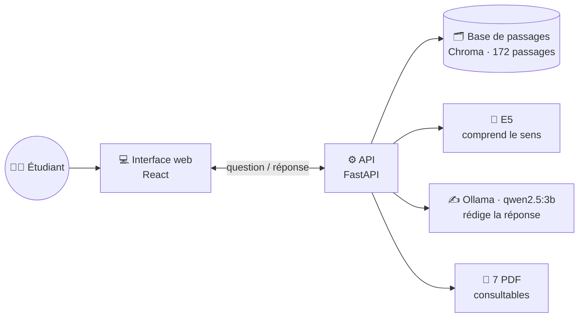
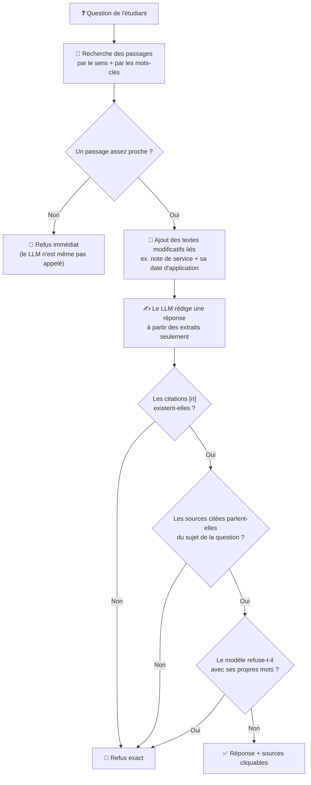
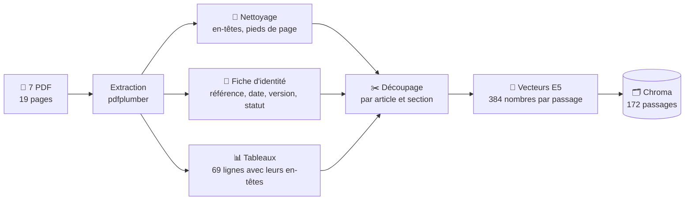
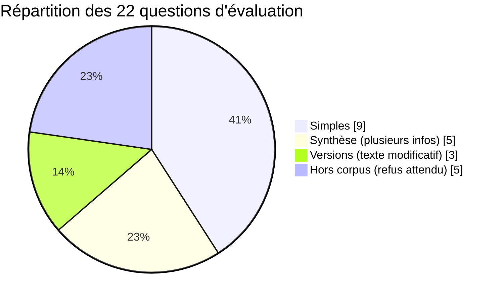
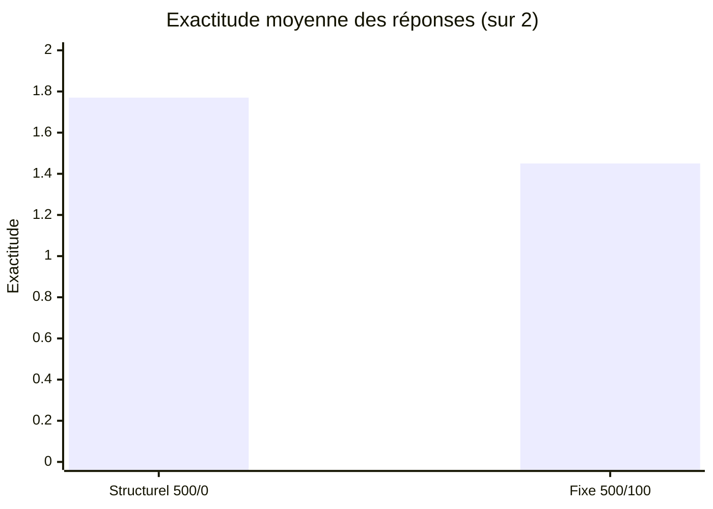
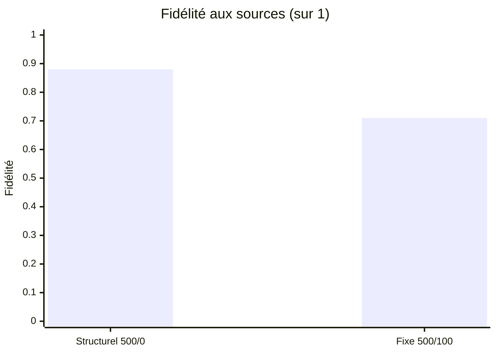
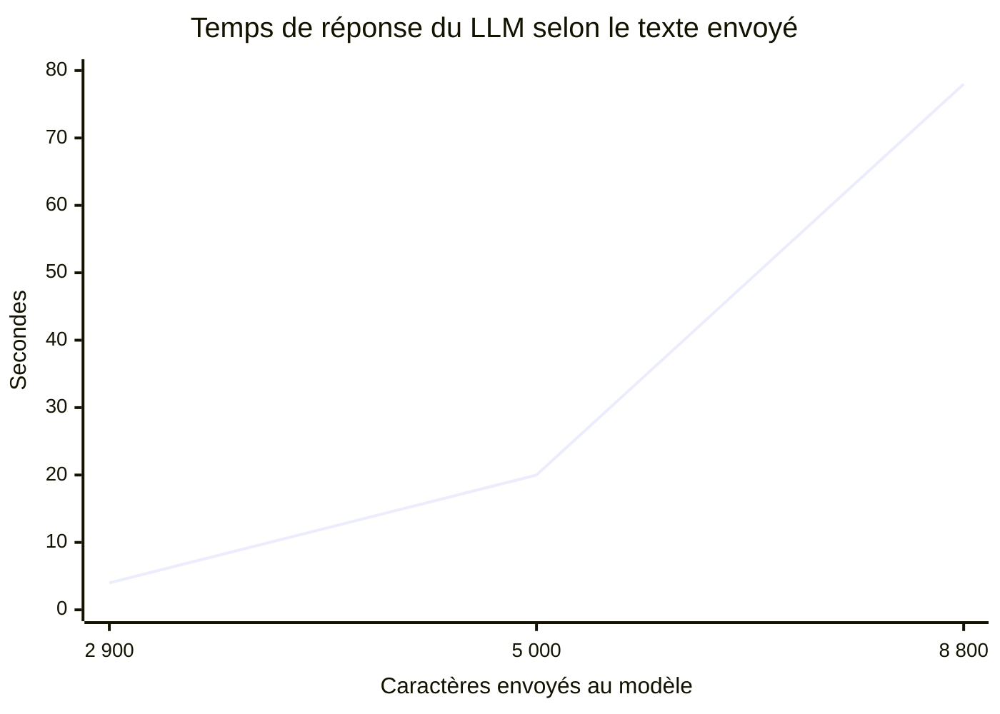

<div align="center">

# ☀️ Hélianthe

### L'école, en plus simple.

**Un assistant qui répond aux questions des étudiants à partir des documents officiels de leur école,
en citant ses sources, et qui sait dire « je ne sais pas ».**


Projet RAG du module **3ACINFO** — Pr. Habib Ayad

</div>

---

## Le contexte

À l'**École d'Ingénieurs Hélianthe** (une école fictive créée pour ce projet), les règles de la
scolarité sont réparties dans **7 documents officiels** : règlement des études, guide des stages,
calendrier, charte de mobilité, guide de la vie étudiante, FAQ et note de service.

Un étudiant qui se demande *« quand dois-je déposer ma convention de stage ? »* ou *« combien de
semaines doit durer mon PFE ? »* doit aujourd'hui :

- 📚 **chercher** dans plusieurs PDF, sans savoir lequel contient la réponse ;
- 🔄 **comparer des versions** : une note de service publiée en octobre peut modifier le guide de
  juin, mais seulement pour certains étudiants et à partir d'une certaine date ;
- ⚖️ **savoir quel texte fait foi** : une FAQ plus récente ne remplace pas le règlement.

Un chatbot classique répondrait vite, mais il pourrait **inventer** une règle qui n'existe pas.
Pour une question de scolarité, une réponse fausse coûte cher : un délai raté, un stage non validé.

## Notre réponse : Hélianthe

Hélianthe repose sur le **RAG** (*Retrieval-Augmented Generation*) : avant de répondre, il
**cherche** les passages utiles dans les documents, puis il **rédige** une réponse à partir de ces
passages **uniquement**.

| Principe | Ce que ça change pour l'étudiant |
|---|---|
| 📎 **Chaque affirmation est sourcée** | Un clic sur `[1]` ouvre le passage exact et le PDF à la bonne page |
| 🚫 **Pas de réponse inventée** | S'il ne trouve pas, il répond : *« Je ne trouve pas cette information dans les documents de l'École. »* |
| 🕐 **Les versions sont prises en compte** | Il signale quand une note de service modifie une règle, et pour qui |
| 💬 **Langage naturel** | Une vraie question ou de simples mots-clés : « pfe », « convention de stage » |
| 🔒 **Tout en local** | Les documents et les questions ne quittent pas l'ordinateur, sans clé ni abonnement |

### Exemples réels

> **Étudiant :** Quand faut-il déposer la convention de stage ?
>
> **Hélianthe :** La convention de stage doit être déposée sur le Portail Stages au moins
> 15 jours calendaires avant le début du stage. **[1]**
> <sub>[1] Guide des stages et du PFE · EIH-SRE-GUIDE-2026 · p. 1</sub>

> **Étudiant :** total des places de mobilité
>
> **Hélianthe :** Au total, 16 places de semestre d'études sont ouvertes, dont 5 places en double
> diplôme (Institut Nordique : 3 ; Hochschule Lindenfeld : 2). **[1]**

> **Étudiant :** Quelle est la durée minimale d'un PFE qui commence en février 2027 ?
>
> **Hélianthe :** 18 semaines, selon la note de service 2026-14, qui modifie le guide des stages
> pour les PFE débutant à partir du 1er février 2027. **[1] [4]**

> **Étudiant :** Quel est le prix du repas au restaurant de l'École ?
>
> **Hélianthe :** *Je ne trouve pas cette information dans les documents de l'École.*
> <sub>Le guide donne les horaires du restaurant, mais aucun prix : il refuse plutôt que d'inventer.</sub>

### Ce que contient l'interface

- 💬 **Conversation** avec deux compagnons, Saad et Mohamed, qui interrogent la même base
- 📎 **Citations cliquables** : le passage exact, sa référence, sa date, sa version et son statut
- 📄 **Bibliothèque** : les 7 documents, avec recherche, filtre par type, ouverture et téléchargement
- 🔎 **Recherche avancée** : les passages trouvés et leurs scores, sans appel au LLM
- ⚙️ **Paramètres** : nombre de passages (1 à 10) et filtre par type de document
- 📱 **Affichage mobile** et gestion claire des erreurs (serveur, modèle, saisie)

---

## Comment ça marche, en clair

Imaginez un **bibliothécaire rigoureux**. Il a lu et classé chaque paragraphe des 7 documents.
Quand on lui pose une question, il retrouve les passages utiles, rédige une réponse courte en
citant ses fiches, puis un **contrôleur** vérifie que la réponse s'appuie bien sur ces fiches.



### Le trajet d'une question



Ces **garde-fous** sont écrits dans le code, pas seulement demandés au modèle : même si le LLM se
trompe, une réponse sans source valide n'arrive jamais à l'étudiant.

---

## Les documents

| # | Document | Référence | Publication | Version | Statut |
|---|---|---|---|---|---|
| 01 | Règlement des études 2026-2027 | EIH-DE-REG-2026 | 10/07/2026 | 1.0 | En vigueur à compter du 14/09/2026 |
| 02 | Guide des stages et du PFE | EIH-SRE-GUIDE-2026 | 15/06/2026 | 3.0 | En vigueur, sous réserve des notes de service |
| 03 | Charte de mobilité internationale | EIH-BRI-CHARTE-2026 | 20/04/2026 | 2.1 | En vigueur |
| 04 | Calendrier académique 2026-2027 | EIH-DE-CAL-2026 | 10/07/2026 | 1.0 | En vigueur |
| 05 | Guide de la vie étudiante | EIH-BVE-GUIDE-2026 | 01/09/2026 | 1.2 | En vigueur |
| 06 | FAQ Scolarité | EIH-SCOL-FAQ-2026 | 21/09/2026 | 1.0 | Information : les textes réglementaires prévalent |
| 07 | Note de service 2026-14 | EIH-DE-NS-2026-14 | 05/10/2026 | 1.0 | **Texte modificatif** du guide des stages |

### De 7 PDF à 172 passages interrogeables



Deux façons de découper ont été comparées :

- **Fixe** : des tranches de 500 caractères qui se chevauchent de 100. C'est simple, mais une règle
  peut être coupée en deux.
- **Structurelle** : on repère les 98 titres (articles, sections, questions de FAQ) et chaque
  passage garde son titre, par exemple *« 5. PFE > 5.3 Durée et période »*.

---

## Résultats

Nous avons évalué Hélianthe sur **22 questions** dont les réponses attendues ont été vérifiées
dans les PDF, dont 5 pièges hors corpus où la seule bonne réponse est le refus.



### Découpage structurel contre découpage fixe





| Indicateur | 🏆 Structurel 500/0 | Fixe 500/100 |
|---|---|---|
| Passages indexés | 172 | 151 |
| Bon document dans les 5 premiers (Hit@5) | 100 % | 100 % |
| Rang moyen du bon document (MRR) | **1,00** | 0,94 |
| Exactitude (sur 2) | **1,77** | 1,45 |
| Fidélité aux sources | **0,88** | 0,71 |
| Pièges hors corpus correctement refusés | **5/5** | 4/5 |
| Refus à tort | 0/17 | 0/17 |
| Temps de réponse médian | 34 s | 33 s |

**À retenir :** le découpage structurel donne de meilleures réponses **sans coûter plus de temps**.
Avec le découpage fixe, le passage annonçant « 16 places » a été coupé, et le modèle a répondu
« 4 places » à partir d'une seule ligne de tableau.

### Pourquoi la taille du contexte compte

Sur un processeur de portable sans carte graphique, le temps de réponse grimpe très vite avec la
quantité de texte envoyée au modèle (mesures faites pendant la mise au point) :



C'est pourquoi Hélianthe n'ajoute que les **2 passages les plus utiles** d'un texte modificatif,
plus son champ d'application, au lieu du texte entier.

<sub>Matériel des mesures : Intel Core i5-1145G7 (4 cœurs), 16 Go de RAM, sans carte graphique ·
LLM qwen2.5:3b en local · top_k = 5. Exactitude et fidélité calculées automatiquement à partir
d'éléments clés, puis vérifiées à la main.</sub>

---

## Ce qu'on a appris en chemin

| 🧩 Problème rencontré | 🔧 Ce qu'on a fait |
|---|---|
| Le premier modèle d'embedding (MiniLM) ne lisait que 128 tokens, et certains passages étaient tronqués | Passage à **E5 multilingue** (512 tokens). Le plus long passage en fait 157 |
| La première question prenait ~21 s de plus (chargement des modèles) | **Préchauffage** au démarrage du serveur, et modèle gardé 30 min en mémoire |
| Le chatbot refusait la question sur la convention alors que la réponse était dans l'extrait [1] | Nouveau prompt : le modèle liste d'abord ses **preuves**, et la question est placée après les extraits |
| Toute la note de service était ajoutée au contexte : 15 extraits et 78 s d'attente | Ajout **ciblé** : 2 passages + le champ d'application seulement |
| Le modèle écrivait `[1, 2]`, que le contrôle ne reconnaissait pas | **Normalisation** automatique en `[1] [2]` |
| « total des places de mobilité » : le bon passage arrivait 8e | **Recherche hybride** : un petit bonus pour les mots-clés de la question |
| Pour « journée d'intégration » (absente du corpus), le modèle inventait une réponse à partir d'un passage hors sujet | **Contrôle de sujet** : les sources citées doivent contenir les mots importants de la question |
| Le modèle refusait avec ses propres mots (« n'est pas mentionné ») | Ces formulations sont remplacées par la **phrase de refus exacte** |

---

## Démarrage rapide

> Prérequis : [uv](https://docs.astral.sh/uv/), [Ollama](https://ollama.com/) et Node.js ≥ 20.

**Première installation**

```powershell
uv sync                                                  # dépendances Python
ollama pull qwen2.5:3b                                   # modèle de langage (~2 Go)
Copy-Item .env.example .env                              # configuration (HF_HUB_OFFLINE=0 la 1re fois)
uv run python -u src/assistant_scolarite/indexation.py   # base de 172 passages

cd Helianthe_frontend\frontend
npm ci
Copy-Item .env.example .env
cd ..\..
```

**À chaque utilisation : deux terminaux**

```powershell
# Terminal 1 : backend (attendre « Application startup complete. »)
uv run python -m uvicorn api:app --app-dir src/assistant_scolarite --reload
```

```powershell
# Terminal 2 : interface
cd Helianthe_frontend\frontend
npm run dev
```

Puis ouvrir 👉 **http://127.0.0.1:5173**. La documentation de l'API est sur http://127.0.0.1:8000/docs.

---

<details>
<summary><b>⚙️ Configuration (.env)</b></summary>

| Variable | Rôle | Défaut |
|---|---|---|
| `LLM_PROVIDER` | `ollama` (local) ou `api` (fournisseur compatible OpenAI) | `ollama` |
| `OLLAMA_MODEL` | Modèle génératif | `qwen2.5:3b` |
| `OLLAMA_TIMEOUT` | Délai maximal d'une réponse (s) | `120` |
| `OLLAMA_KEEP_ALIVE` | Durée de maintien du modèle en mémoire | `30m` |
| `RAG_SCORE_THRESHOLD` | Seuil de refus avant le LLM (provisoire) | `0.90` |
| `HF_HUB_OFFLINE` | `1` : E5 chargé depuis le disque, sans Internet | `1` |
| `LLM_API_BASE`, `LLM_API_KEY`, `LLM_MODEL` | Option API, par exemple Groq | vide |

Le fichier `.env` n'est jamais versionné, et aucune clé n'est envoyée au navigateur.

</details>

<details>
<summary><b>🔌 Routes de l'API</b></summary>

| Route | Rôle |
|---|---|
| `GET /api/health` | État de la base et nombre de passages |
| `POST /api/ingest` | Indexe la configuration `structural` (500/0) ou `fixed` (500/100) |
| `GET /api/documents` | Documents indexés : référence, type, date, version, statut |
| `POST /api/search` | Recherche seule : passages, scores, distances |
| `POST /api/ask` | Réponse complète : `answer`, `found`, `sources`, `invalid_citations`, `latency_ms` |
| `GET /api/files/{fichier}` | Ouvre un PDF (`?download=true` pour le télécharger) |

Codes : `422` entrée invalide · `502` LLM indisponible · `503` base indisponible.
Un refus documentaire renvoie `200` avec `found: false`.

</details>

<details>
<summary><b>🧪 Tests et évaluation</b></summary>

```powershell
uv run python -m pytest -q                 # 27 tests (découpage, refus, citations, PDF)
uv run python eval/run_eval.py --sans-llm  # recherche seule, environ 2 min
uv run python eval/run_eval.py             # évaluation complète, environ 25 min
```

Les tests de génération remplacent la base et le LLM par des objets simulés : ils ne nécessitent
ni Chroma ni Ollama. Les résultats d'évaluation sont dans `eval/resultats/`, avec un CSV pour la
notation manuelle.

</details>

<details>
<summary><b>🛠️ Choix techniques</b></summary>

- **Lecture des PDF** : pdfplumber, avec le texte, les tableaux ligne par ligne et le bloc d'identité.
- **Embeddings** : `intfloat/multilingual-e5-small` (384 dimensions, préfixes `query:` / `passage:`).
- **Base** : Chroma persistant, distance cosinus ; `score = 1 − distance / 2`.
- **Recherche hybride** : 20 candidats E5, puis un bonus de 0,05 × la part des mots importants présents.
- **Génération** : réponse JSON imposée par un schéma (`preuves`, `answer`, `found`), température 0.
- **Textes modificatifs** : détectés à partir de leur type et de leur statut, sans référence codée en dur.
- **Contrôles** : citations existantes, normalisation `[1, 2]`, reprise des preuves, sources sur le
  sujet, refus déguisés.
- **LLM interchangeable** : Ollama en local, ou toute API compatible OpenAI via `.env`.

</details>

<details>
<summary><b>📁 Organisation du projet</b></summary>

```
assistant-scolarite/
├── data/corpus/               7 PDF originaux (jamais modifiés)
├── data/processed/            pages, métadonnées, tableaux (JSON)
├── src/assistant_scolarite/   extraction, découpage, indexation, recherche, génération, API
├── tests/                     tests pytest
├── eval/                      22 questions, script d'évaluation, résultats
└── Helianthe_frontend/        interface React + TypeScript
```

</details>

---

## Limites et pistes

- ⏱️ **Environ 30 s par réponse** sur un portable sans carte graphique. Une API (`LLM_PROVIDER=api`)
  ou un GPU ramènerait ce temps à quelques secondes.
- 🧠 Un modèle de 3 milliards de paramètres peut **oublier un détail** ou appliquer un texte
  modificatif hors de sa portée. Nous l'avons observé une fois dans l'évaluation.
- 🎚️ Le seuil de refus (0,90) est **provisoire** : il faudrait le calibrer sur davantage de questions.
- 💬 **Pas de mémoire de conversation** : chaque question est traitée seule.
- 📎 Une citation valide prouve que la source existe, **pas** que chaque mot de la réponse en découle.

---

## Utilisation de l'IA générative

Une partie du code (backend, interface, tests, évaluation) et les illustrations des compagnons
ont été réalisées avec l'aide d'outils d'IA générative. Le binôme a relu, testé et mesuré
l'ensemble. Le détail figure dans l'annexe « Déclaration d'utilisation des outils d'IA générative »
du rapport.

## Auteurs

Binôme du module **3ACINFO** — Université Mundiapolis

- **Saad Idrissi**
- **Mohamed Bouhsassoune** *(à compléter)*

<sub>L'École d'Ingénieurs Hélianthe et son corpus sont fictifs et utilisés à des fins pédagogiques.</sub>